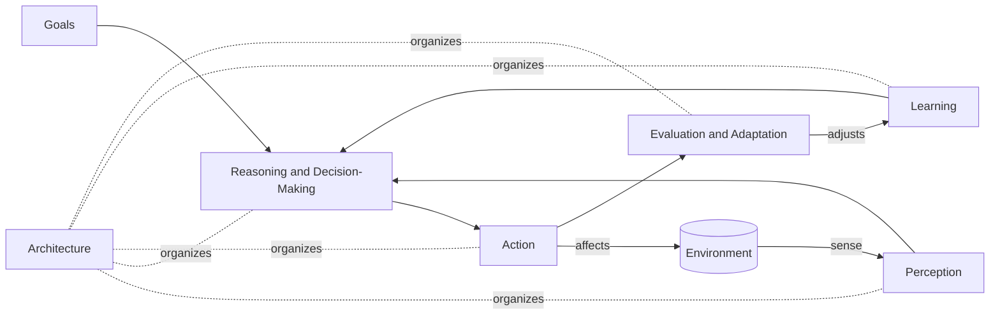
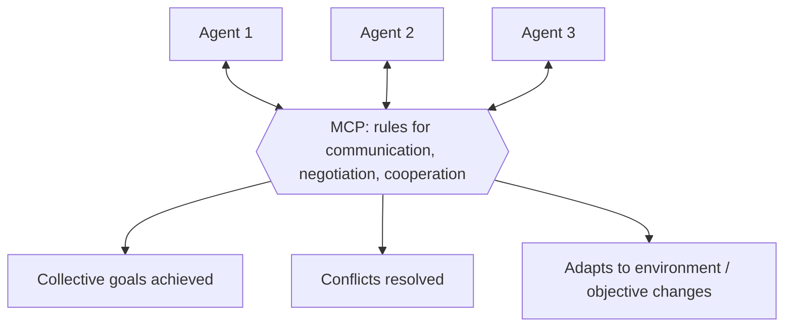
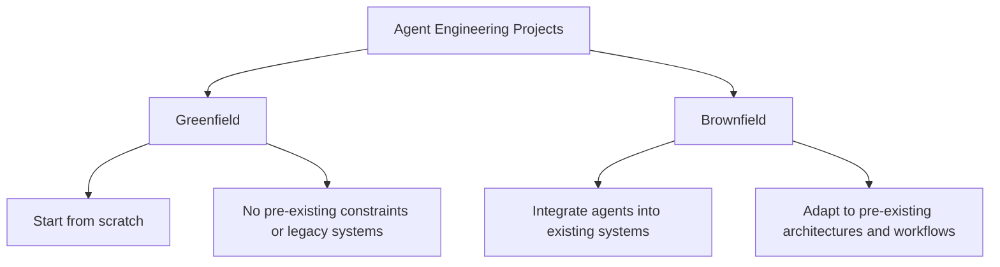
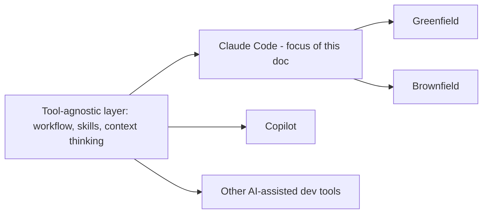
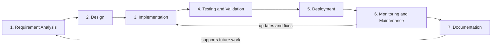
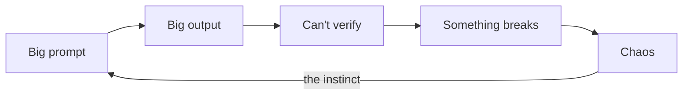

# Agent Engineering Notes

cmd+k then v to open it.

## Table of Contents

- [Agent Engineering Notes](#agent-engineering-notes)
  - [Table of Contents](#table-of-contents)
  - [Table of Contents](#table-of-contents-1)
  - [1. What Is Agent Engineering](#1-what-is-agent-engineering)
  - [2. Key Components of Agent Engineering](#2-key-components-of-agent-engineering)
    - [Diagram: How the components fit together](#diagram-how-the-components-fit-together)
  - [3. What Is MCP](#3-what-is-mcp)
    - [Diagram: Agents coordinated by a protocol](#diagram-agents-coordinated-by-a-protocol)
  - [4. Project Types](#4-project-types)
  - [5. Setup](#5-setup)
  - [6. Workflow Overview](#6-workflow-overview)
    - [What is a workflow?](#what-is-a-workflow)
  - [7. Key Components of an Agent Engineering Workflow](#7-key-components-of-an-agent-engineering-workflow)
    - [Diagram: Workflow lifecycle](#diagram-workflow-lifecycle)
  - [8. The Planning Problem: Why Big Prompts Fail](#8-the-planning-problem-why-big-prompts-fail)
    - [Example: "Build the cart feature"](#example-build-the-cart-feature)
    - [Why this causes issues](#why-this-causes-issues)
    - [The instinct](#the-instinct)
  - [3. What Is MCP](#3-what-is-mcp-1)
    - [Diagram: Agents coordinated by a protocol](#diagram-agents-coordinated-by-a-protocol-1)
  - [4. Project Types](#4-project-types-1)
  - [5. Setup](#5-setup-1)
  - [6. Workflow Overview](#6-workflow-overview-1)
    - [What is a workflow?](#what-is-a-workflow-1)
  - [7. Key Components of an Agent Engineering Workflow](#7-key-components-of-an-agent-engineering-workflow-1)
    - [Diagram: Workflow lifecycle](#diagram-workflow-lifecycle-1)
  - [8. The Planning Problem: Why Big Prompts Fail](#8-the-planning-problem-why-big-prompts-fail-1)
    - [Example: "Build the cart feature"](#example-build-the-cart-feature-1)
    - [Why this causes issues](#why-this-causes-issues-1)
    - [The instinct](#the-instinct-1)
  - [3. What Is MCP](#3-what-is-mcp-2)
    - [Diagram: Agents coordinated by a protocol](#diagram-agents-coordinated-by-a-protocol-2)
  - [4. Project Types](#4-project-types-2)
  - [5. Setup](#5-setup-2)
  - [6. Workflow Overview](#6-workflow-overview-2)
    - [What is a workflow?](#what-is-a-workflow-2)
  - [7. Key Components of an Agent Engineering Workflow](#7-key-components-of-an-agent-engineering-workflow-2)
    - [Diagram: Workflow lifecycle](#diagram-workflow-lifecycle-2)
  - [8. The Planning Problem: Why Big Prompts Fail](#8-the-planning-problem-why-big-prompts-fail-2)
    - [Example: "Build the cart feature"](#example-build-the-cart-feature-2)
    - [Why this causes issues](#why-this-causes-issues-2)
    - [The instinct](#the-instinct-2)
  - [3. What Is MCP](#3-what-is-mcp-3)
    - [Diagram: Agents coordinated by a protocol](#diagram-agents-coordinated-by-a-protocol-3)
  - [4. Project Types](#4-project-types-3)
  - [5. Setup](#5-setup-3)
  - [6. Workflow Overview](#6-workflow-overview-3)
    - [What is a workflow?](#what-is-a-workflow-3)
  - [7. Key Components of an Agent Engineering Workflow](#7-key-components-of-an-agent-engineering-workflow-3)
    - [Diagram: Workflow lifecycle](#diagram-workflow-lifecycle-3)
  - [8. The Planning Problem: Why Big Prompts Fail](#8-the-planning-problem-why-big-prompts-fail-3)
    - [Example: "Build the cart feature"](#example-build-the-cart-feature-3)
    - [Why this causes issues](#why-this-causes-issues-3)
    - [The instinct](#the-instinct-3)
  - [3. What Is MCP](#3-what-is-mcp-4)
    - [Diagram: Agents coordinated by a protocol](#diagram-agents-coordinated-by-a-protocol-4)
  - [4. Project Types](#4-project-types-4)
  - [5. Setup](#5-setup-4)
  - [6. Workflow Overview](#6-workflow-overview-4)
    - [What is a workflow?](#what-is-a-workflow-4)
  - [7. Key Components of an Agent Engineering Workflow](#7-key-components-of-an-agent-engineering-workflow-4)
    - [Diagram: Workflow lifecycle](#diagram-workflow-lifecycle-4)
  - [8. The Planning Problem: Why Big Prompts Fail](#8-the-planning-problem-why-big-prompts-fail-4)
    - [Example: "Build the cart feature"](#example-build-the-cart-feature-4)
    - [Why this causes issues](#why-this-causes-issues-4)
    - [The instinct](#the-instinct-4)
  - [3. What Is MCP](#3-what-is-mcp-5)
    - [Diagram: Agents coordinated by a protocol](#diagram-agents-coordinated-by-a-protocol-5)
  - [4. Project Types](#4-project-types-5)
  - [5. Setup](#5-setup-5)
  - [6. Workflow Overview](#6-workflow-overview-5)
    - [What is a workflow?](#what-is-a-workflow-5)
  - [7. Key Components of an Agent Engineering Workflow](#7-key-components-of-an-agent-engineering-workflow-5)
    - [Diagram: Workflow lifecycle](#diagram-workflow-lifecycle-5)
  - [8. The Planning Problem: Why Big Prompts Fail](#8-the-planning-problem-why-big-prompts-fail-5)
    - [Example: "Build the cart feature"](#example-build-the-cart-feature-5)
    - [Why this causes issues](#why-this-causes-issues-5)
    - [The instinct](#the-instinct-5)
  - [3. What Is MCP](#3-what-is-mcp-6)
    - [Diagram: Agents coordinated by a protocol](#diagram-agents-coordinated-by-a-protocol-6)
  - [4. Project Types](#4-project-types-6)
  - [5. Setup](#5-setup-6)
  - [6. Workflow Overview](#6-workflow-overview-6)
    - [What is a workflow?](#what-is-a-workflow-6)
  - [7. Key Components of an Agent Engineering Workflow](#7-key-components-of-an-agent-engineering-workflow-6)
    - [Diagram: Workflow lifecycle](#diagram-workflow-lifecycle-6)
  - [8. The Planning Problem: Why Big Prompts Fail](#8-the-planning-problem-why-big-prompts-fail-6)
    - [Example: "Build the cart feature"](#example-build-the-cart-feature-6)
    - [Why this causes issues](#why-this-causes-issues-6)
    - [The instinct](#the-instinct-6)
  - [3. What Is MCP](#3-what-is-mcp-7)
    - [Diagram: Agents coordinated by a protocol](#diagram-agents-coordinated-by-a-protocol-7)
  - [4. Project Types](#4-project-types-7)
  - [5. Setup](#5-setup-7)
  - [6. Workflow Overview](#6-workflow-overview-7)
    - [What is a workflow?](#what-is-a-workflow-7)
  - [7. Key Components of an Agent Engineering Workflow](#7-key-components-of-an-agent-engineering-workflow-7)
    - [Diagram: Workflow lifecycle](#diagram-workflow-lifecycle-7)
  - [8. The Planning Problem: Why Big Prompts Fail](#8-the-planning-problem-why-big-prompts-fail-7)
    - [Example: "Build the cart feature"](#example-build-the-cart-feature-7)
    - [Why this causes issues](#why-this-causes-issues-7)
    - [The instinct](#the-instinct-7)
  - [3. What Is MCP](#3-what-is-mcp-8)
    - [Diagram: Agents coordinated by a protocol](#diagram-agents-coordinated-by-a-protocol-8)
  - [4. Project Types](#4-project-types-8)
  - [5. Setup](#5-setup-8)
  - [6. Workflow Overview](#6-workflow-overview-8)
    - [What is a workflow?](#what-is-a-workflow-8)
  - [7. Key Components of an Agent Engineering Workflow](#7-key-components-of-an-agent-engineering-workflow-8)
    - [Diagram: Workflow lifecycle](#diagram-workflow-lifecycle-8)
  - [8. The Planning Problem: Why Big Prompts Fail](#8-the-planning-problem-why-big-prompts-fail-8)
    - [Example: "Build the cart feature"](#example-build-the-cart-feature-8)
    - [Why this causes issues](#why-this-causes-issues-8)
    - [The instinct](#the-instinct-8)
  - [3. What Is MCP](#3-what-is-mcp-9)
    - [Diagram: Agents coordinated by a protocol](#diagram-agents-coordinated-by-a-protocol-9)
  - [4. Project Types](#4-project-types-9)
  - [5. Setup](#5-setup-9)
  - [6. Workflow Overview](#6-workflow-overview-9)
    - [What is a workflow?](#what-is-a-workflow-9)
  - [7. Key Components of an Agent Engineering Workflow](#7-key-components-of-an-agent-engineering-workflow-9)
    - [Diagram: Workflow lifecycle](#diagram-workflow-lifecycle-9)
  - [8. The Planning Problem: Why Big Prompts Fail](#8-the-planning-problem-why-big-prompts-fail-9)
    - [Example: "Build the cart feature"](#example-build-the-cart-feature-9)
    - [Why this causes issues](#why-this-causes-issues-9)
    - [The instinct](#the-instinct-9)
  - [3. What Is MCP](#3-what-is-mcp-10)
    - [Diagram: Agents coordinated by a protocol](#diagram-agents-coordinated-by-a-protocol-10)
  - [4. Project Types](#4-project-types-10)
  - [5. Setup](#5-setup-10)
  - [6. Workflow Overview](#6-workflow-overview-10)
    - [What is a workflow?](#what-is-a-workflow-10)
  - [7. Key Components of an Agent Engineering Workflow](#7-key-components-of-an-agent-engineering-workflow-10)
    - [Diagram: Workflow lifecycle](#diagram-workflow-lifecycle-10)
  - [8. The Planning Problem: Why Big Prompts Fail](#8-the-planning-problem-why-big-prompts-fail-10)
    - [Example: "Build the cart feature"](#example-build-the-cart-feature-10)
    - [Why this causes issues](#why-this-causes-issues-10)
    - [The instinct](#the-instinct-10)

## Table of Contents

1. [What Is Agent Engineering](#1-what-is-agent-engineering)
2. [Key Components of Agent Engineering](#2-key-components-of-agent-engineering)
3. [What Is MCP](#3-what-is-mcp)
4. [Project Types](#4-project-types)
5. [Setup](#5-setup)
6. [Workflow Overview](#6-workflow-overview)
7. [Key Components of an Agent Engineering Workflow](#7-key-components-of-an-agent-engineering-workflow)
8. [The Planning Problem: Why Big Prompts Fail](#8-the-planning-problem-why-big-prompts-fail)

---

## 1. What Is Agent Engineering

- Agent engineering is the practice of designing, building, and managing intelligent agents that can autonomously perform tasks, make decisions, and interact with their environment.
- It involves understanding the agent's goals, capabilities, and the environment in which it operates, as well as implementing algorithms and architectures that enable intelligent behavior.
- It also requires continuous monitoring, evaluation, and adaptation of the agent's behavior to ensure it remains effective and aligned with its intended objectives.

---

## 2. Key Components of Agent Engineering

| Component | Description |
|---|---|
| **Goals** | Clearly defined objectives that the agent is designed to achieve. |
| **Perception** | The ability of the agent to sense and interpret its environment. |
| **Reasoning and Decision-Making** | Algorithms and mechanisms that allow the agent to make informed decisions based on its goals and perceptions. |
| **Learning** | The capability of the agent to improve its performance over time through experience. |
| **Action** | The means by which the agent interacts with and affects its environment. |
| **Architecture** | The underlying structure and design of the agent, including how its components are organized and interact. |
| **Evaluation and Adaptation** | Continuous monitoring and adjustment of the agent's behavior to ensure it remains effective and aligned with its objectives. |

### Diagram: How the components fit together



---

## 3. What Is MCP

- MCP stands for **Multiagent Control Protocol**.
- It is a framework or protocol used to coordinate and manage the interactions and behaviors of multiple intelligent agents within a system.
- MCP defines the rules and mechanisms for communication, negotiation, and cooperation among agents to achieve collective goals.
- It helps ensure that agents can work together effectively, resolve conflicts, and adapt to changes in the environment or the system's objectives.

> **Editor's note:** In the Claude / Anthropic ecosystem, MCP normally stands for **Model Context Protocol**, an open standard for connecting AI applications to external tools and data. The definition above is kept as originally written; please verify which meaning you intend.

### Diagram: Agents coordinated by a protocol



---

## 4. Project Types

There are two types of projects:

- **Greenfield Projects:** Projects that start from scratch, where the agent system is designed and built without any pre-existing constraints or legacy systems.
- **Brownfield Projects:** Projects that involve integrating intelligent agents into existing systems, requiring adaptation to pre-existing architectures and workflows.



---

## 5. Setup

The workflow, the skills, and the context thinking are **tool agnostic**.

We are using **Claude Code** for our agent engineering setup and workflow.

Claude Code provides the necessary tools and environment to design, implement, and manage intelligent agents effectively, supporting both Greenfield and Brownfield projects.

In the same way, we can use Copilot or other AI-assisted development tools to support our agent engineering setup and workflow.

This doc is mostly focused on the Claude Code setup and workflow for agent engineering.



---

## 6. Workflow Overview

### What is a workflow?

- A workflow in agent engineering refers to the structured sequence of steps, processes, and interactions involved in designing, building, and managing intelligent agents.
- It encompasses the tasks, tools, and methodologies used to ensure that agents are developed effectively and operate as intended within their environment.
- A well-defined workflow helps streamline the agent engineering process, improves collaboration among team members, and facilitates the integration of various tools and technologies.
- It provides a clear roadmap for the development process, helping teams manage complexity, track progress, and ensure that all necessary steps are completed systematically.

---

## 7. Key Components of an Agent Engineering Workflow

| # | Stage | Description |
|---|---|---|
| 1 | **Requirement Analysis** | Identifying and understanding the goals, constraints, and requirements for the intelligent agents within the system. |
| 2 | **Design** | Creating the architecture, defining agent roles, interactions, and communication protocols, and planning the overall system structure. |
| 3 | **Implementation** | Developing the agents using appropriate programming languages, frameworks, and tools, ensuring they adhere to the design specifications. |
| 4 | **Testing and Validation** | Verifying that the agents function correctly, meet the requirements, and interact as intended within the environment. |
| 5 | **Deployment** | Integrating the agents into the target environment and ensuring they operate effectively in real-world conditions. |
| 6 | **Monitoring and Maintenance** | Continuously observing agent performance, addressing issues, and making necessary updates to maintain optimal functionality. |
| 7 | **Documentation** | Maintaining comprehensive records of the design, implementation, and operational procedures to support future development and maintenance efforts. |

### Diagram: Workflow lifecycle



---

## 8. The Planning Problem: Why Big Prompts Fail

Modern agents plan: they read files, map an approach, run tests, and self-correct. But the real problem is **what the plan aims at**.

> **What you said is what you get. The rest is default: everything you left unsaid.**

### Example: "Build the cart feature"

You say *build the cart feature*. The agent makes 10 decisions that you didn't see:

- State shape
- API surface
- Error handling
- Persistence
- ...and 6 more aspects that are crucial for the feature's robustness and integration.

It doesn't ask. It picks.

### Why this causes issues

When it makes mistakes, it changes a lot of files at once, which makes it hard to debug and hard to understand the root cause. This is the cycle most developers are stuck in:

**big prompt → big output → can't verify → something breaks → chaos**



### The instinct

When chaos hits, the usual reaction is:

- Keep prompting, with more detail
- Try a different model
- Start a new chat

```mermaid
flowchart TB
    CH[Chaos] --> I1[Keep prompting, more detail]
    CH --> I2[A different model]
    CH --> I3[A new chat]
    I1 --> BP[Another big prompt]
    I2 --> BP
    I3 --> BP
    BP --> CH
```# Agent Engineering Notes

## Table of Contents

1. [What Is Agent Engineering](#1-what-is-agent-engineering)
2. [Key Components of Agent Engineering](#2-key-components-of-agent-engineering)
3. [What Is MCP](#3-what-is-mcp)
4. [Project Types](#4-project-types)
5. [Setup](#5-setup)
6. [Workflow Overview](#6-workflow-overview)
7. [Key Components of an Agent Engineering Workflow](#7-key-components-of-an-agent-engineering-workflow)
8. [The Planning Problem: Why Big Prompts Fail](#8-the-planning-problem-why-big-prompts-fail)

---

## 1. What Is Agent Engineering

- Agent engineering is the practice of designing, building, and managing intelligent agents that can autonomously perform tasks, make decisions, and interact with their environment.
- It involves understanding the agent's goals, capabilities, and the environment in which it operates, as well as implementing algorithms and architectures that enable intelligent behavior.
- It also requires continuous monitoring, evaluation, and adaptation of the agent's behavior to ensure it remains effective and aligned with its intended objectives.

---

## 2. Key Components of Agent Engineering

| Component | Description |
|---|---|
| **Goals** | Clearly defined objectives that the agent is designed to achieve. |
| **Perception** | The ability of the agent to sense and interpret its environment. |
| **Reasoning and Decision-Making** | Algorithms and mechanisms that allow the agent to make informed decisions based on its goals and perceptions. |
| **Learning** | The capability of the agent to improve its performance over time through experience. |
| **Action** | The means by which the agent interacts with and affects its environment. |
| **Architecture** | The underlying structure and design of the agent, including how its components are organized and interact. |
| **Evaluation and Adaptation** | Continuous monitoring and adjustment of the agent's behavior to ensure it remains effective and aligned with its objectives. |

### Diagram: How the components fit together

```mermaid
flowchart LR
    G[Goals] --> R[Reasoning and Decision-Making]
    E[(Environment)] -->|sense| P[Perception]
    P --> R
    R --> A[Action]
    A -->|affects| E
    A --> EV[Evaluation and Adaptation]
    EV -->|adjusts| L[Learning]
    L --> R
    ARCH[Architecture] -.organizes.- P
    ARCH -.organizes.- R
    ARCH -.organizes.- A
    ARCH -.organizes.- L
    ARCH -.organizes.- EV
```

---

## 3. What Is MCP

- MCP stands for **Multiagent Control Protocol**.
- It is a framework or protocol used to coordinate and manage the interactions and behaviors of multiple intelligent agents within a system.
- MCP defines the rules and mechanisms for communication, negotiation, and cooperation among agents to achieve collective goals.
- It helps ensure that agents can work together effectively, resolve conflicts, and adapt to changes in the environment or the system's objectives.

> **Editor's note:** In the Claude / Anthropic ecosystem, MCP normally stands for **Model Context Protocol**, an open standard for connecting AI applications to external tools and data. The definition above is kept as originally written; please verify which meaning you intend.

### Diagram: Agents coordinated by a protocol


---

## 4. Project Types

There are two types of projects:

- **Greenfield Projects:** Projects that start from scratch, where the agent system is designed and built without any pre-existing constraints or legacy systems.
- **Brownfield Projects:** Projects that involve integrating intelligent agents into existing systems, requiring adaptation to pre-existing architectures and workflows.


---

## 5. Setup

The workflow, the skills, and the context thinking are **tool agnostic**.

We are using **Claude Code** for our agent engineering setup and workflow.

Claude Code provides the necessary tools and environment to design, implement, and manage intelligent agents effectively, supporting both Greenfield and Brownfield projects.

In the same way, we can use Copilot or other AI-assisted development tools to support our agent engineering setup and workflow.

This doc is mostly focused on the Claude Code setup and workflow for agent engineering.


---

## 6. Workflow Overview

### What is a workflow?

- A workflow in agent engineering refers to the structured sequence of steps, processes, and interactions involved in designing, building, and managing intelligent agents.
- It encompasses the tasks, tools, and methodologies used to ensure that agents are developed effectively and operate as intended within their environment.
- A well-defined workflow helps streamline the agent engineering process, improves collaboration among team members, and facilitates the integration of various tools and technologies.
- It provides a clear roadmap for the development process, helping teams manage complexity, track progress, and ensure that all necessary steps are completed systematically.

---

## 7. Key Components of an Agent Engineering Workflow

| # | Stage | Description |
|---|---|---|
| 1 | **Requirement Analysis** | Identifying and understanding the goals, constraints, and requirements for the intelligent agents within the system. |
| 2 | **Design** | Creating the architecture, defining agent roles, interactions, and communication protocols, and planning the overall system structure. |
| 3 | **Implementation** | Developing the agents using appropriate programming languages, frameworks, and tools, ensuring they adhere to the design specifications. |
| 4 | **Testing and Validation** | Verifying that the agents function correctly, meet the requirements, and interact as intended within the environment. |
| 5 | **Deployment** | Integrating the agents into the target environment and ensuring they operate effectively in real-world conditions. |
| 6 | **Monitoring and Maintenance** | Continuously observing agent performance, addressing issues, and making necessary updates to maintain optimal functionality. |
| 7 | **Documentation** | Maintaining comprehensive records of the design, implementation, and operational procedures to support future development and maintenance efforts. |

### Diagram: Workflow lifecycle


---

## 8. The Planning Problem: Why Big Prompts Fail

Modern agents plan: they read files, map an approach, run tests, and self-correct. But the real problem is **what the plan aims at**.

> **What you said is what you get. The rest is default: everything you left unsaid.**

### Example: "Build the cart feature"

You say *build the cart feature*. The agent makes 10 decisions that you didn't see:

- State shape
- API surface
- Error handling
- Persistence
- ...and 6 more aspects that are crucial for the feature's robustness and integration.

It doesn't ask. It picks.

### Why this causes issues

When it makes mistakes, it changes a lot of files at once, which makes it hard to debug and hard to understand the root cause. This is the cycle most developers are stuck in:

**big prompt → big output → can't verify → something breaks → chaos**


### The instinct

When chaos hits, the usual reaction is:

- Keep prompting, with more detail
- Try a different model
- Start a new chat

```mermaid
flowchart TB
    CH[Chaos] --> I1[Keep prompting, more detail]
    CH --> I2[A different model]
    CH --> I3[A new chat]
    I1 --> BP[Another big prompt]
    I2 --> BP
    I3 --> BP
    BP --> CH
```# Agent Engineering Notes

## Table of Contents

1. [What Is Agent Engineering](#1-what-is-agent-engineering)
2. [Key Components of Agent Engineering](#2-key-components-of-agent-engineering)
3. [What Is MCP](#3-what-is-mcp)
4. [Project Types](#4-project-types)
5. [Setup](#5-setup)
6. [Workflow Overview](#6-workflow-overview)
7. [Key Components of an Agent Engineering Workflow](#7-key-components-of-an-agent-engineering-workflow)
8. [The Planning Problem: Why Big Prompts Fail](#8-the-planning-problem-why-big-prompts-fail)

---

## 1. What Is Agent Engineering

- Agent engineering is the practice of designing, building, and managing intelligent agents that can autonomously perform tasks, make decisions, and interact with their environment.
- It involves understanding the agent's goals, capabilities, and the environment in which it operates, as well as implementing algorithms and architectures that enable intelligent behavior.
- It also requires continuous monitoring, evaluation, and adaptation of the agent's behavior to ensure it remains effective and aligned with its intended objectives.

---

## 2. Key Components of Agent Engineering

| Component | Description |
|---|---|
| **Goals** | Clearly defined objectives that the agent is designed to achieve. |
| **Perception** | The ability of the agent to sense and interpret its environment. |
| **Reasoning and Decision-Making** | Algorithms and mechanisms that allow the agent to make informed decisions based on its goals and perceptions. |
| **Learning** | The capability of the agent to improve its performance over time through experience. |
| **Action** | The means by which the agent interacts with and affects its environment. |
| **Architecture** | The underlying structure and design of the agent, including how its components are organized and interact. |
| **Evaluation and Adaptation** | Continuous monitoring and adjustment of the agent's behavior to ensure it remains effective and aligned with its objectives. |

### Diagram: How the components fit together

```mermaid
flowchart LR
    G[Goals] --> R[Reasoning and Decision-Making]
    E[(Environment)] -->|sense| P[Perception]
    P --> R
    R --> A[Action]
    A -->|affects| E
    A --> EV[Evaluation and Adaptation]
    EV -->|adjusts| L[Learning]
    L --> R
    ARCH[Architecture] -.organizes.- P
    ARCH -.organizes.- R
    ARCH -.organizes.- A
    ARCH -.organizes.- L
    ARCH -.organizes.- EV
```

---

## 3. What Is MCP

- MCP stands for **Multiagent Control Protocol**.
- It is a framework or protocol used to coordinate and manage the interactions and behaviors of multiple intelligent agents within a system.
- MCP defines the rules and mechanisms for communication, negotiation, and cooperation among agents to achieve collective goals.
- It helps ensure that agents can work together effectively, resolve conflicts, and adapt to changes in the environment or the system's objectives.

> **Editor's note:** In the Claude / Anthropic ecosystem, MCP normally stands for **Model Context Protocol**, an open standard for connecting AI applications to external tools and data. The definition above is kept as originally written; please verify which meaning you intend.

### Diagram: Agents coordinated by a protocol


---

## 4. Project Types

There are two types of projects:

- **Greenfield Projects:** Projects that start from scratch, where the agent system is designed and built without any pre-existing constraints or legacy systems.
- **Brownfield Projects:** Projects that involve integrating intelligent agents into existing systems, requiring adaptation to pre-existing architectures and workflows.


---

## 5. Setup

The workflow, the skills, and the context thinking are **tool agnostic**.

We are using **Claude Code** for our agent engineering setup and workflow.

Claude Code provides the necessary tools and environment to design, implement, and manage intelligent agents effectively, supporting both Greenfield and Brownfield projects.

In the same way, we can use Copilot or other AI-assisted development tools to support our agent engineering setup and workflow.

This doc is mostly focused on the Claude Code setup and workflow for agent engineering.


---

## 6. Workflow Overview

### What is a workflow?

- A workflow in agent engineering refers to the structured sequence of steps, processes, and interactions involved in designing, building, and managing intelligent agents.
- It encompasses the tasks, tools, and methodologies used to ensure that agents are developed effectively and operate as intended within their environment.
- A well-defined workflow helps streamline the agent engineering process, improves collaboration among team members, and facilitates the integration of various tools and technologies.
- It provides a clear roadmap for the development process, helping teams manage complexity, track progress, and ensure that all necessary steps are completed systematically.

---

## 7. Key Components of an Agent Engineering Workflow

| # | Stage | Description |
|---|---|---|
| 1 | **Requirement Analysis** | Identifying and understanding the goals, constraints, and requirements for the intelligent agents within the system. |
| 2 | **Design** | Creating the architecture, defining agent roles, interactions, and communication protocols, and planning the overall system structure. |
| 3 | **Implementation** | Developing the agents using appropriate programming languages, frameworks, and tools, ensuring they adhere to the design specifications. |
| 4 | **Testing and Validation** | Verifying that the agents function correctly, meet the requirements, and interact as intended within the environment. |
| 5 | **Deployment** | Integrating the agents into the target environment and ensuring they operate effectively in real-world conditions. |
| 6 | **Monitoring and Maintenance** | Continuously observing agent performance, addressing issues, and making necessary updates to maintain optimal functionality. |
| 7 | **Documentation** | Maintaining comprehensive records of the design, implementation, and operational procedures to support future development and maintenance efforts. |

### Diagram: Workflow lifecycle


---

## 8. The Planning Problem: Why Big Prompts Fail

Modern agents plan: they read files, map an approach, run tests, and self-correct. But the real problem is **what the plan aims at**.

> **What you said is what you get. The rest is default: everything you left unsaid.**

### Example: "Build the cart feature"

You say *build the cart feature*. The agent makes 10 decisions that you didn't see:

- State shape
- API surface
- Error handling
- Persistence
- ...and 6 more aspects that are crucial for the feature's robustness and integration.

It doesn't ask. It picks.

### Why this causes issues

When it makes mistakes, it changes a lot of files at once, which makes it hard to debug and hard to understand the root cause. This is the cycle most developers are stuck in:

**big prompt → big output → can't verify → something breaks → chaos**


### The instinct

When chaos hits, the usual reaction is:

- Keep prompting, with more detail
- Try a different model
- Start a new chat

```mermaid
flowchart TB
    CH[Chaos] --> I1[Keep prompting, more detail]
    CH --> I2[A different model]
    CH --> I3[A new chat]
    I1 --> BP[Another big prompt]
    I2 --> BP
    I3 --> BP
    BP --> CH
```# Agent Engineering Notes

## Table of Contents

1. [What Is Agent Engineering](#1-what-is-agent-engineering)
2. [Key Components of Agent Engineering](#2-key-components-of-agent-engineering)
3. [What Is MCP](#3-what-is-mcp)
4. [Project Types](#4-project-types)
5. [Setup](#5-setup)
6. [Workflow Overview](#6-workflow-overview)
7. [Key Components of an Agent Engineering Workflow](#7-key-components-of-an-agent-engineering-workflow)
8. [The Planning Problem: Why Big Prompts Fail](#8-the-planning-problem-why-big-prompts-fail)

---

## 1. What Is Agent Engineering

- Agent engineering is the practice of designing, building, and managing intelligent agents that can autonomously perform tasks, make decisions, and interact with their environment.
- It involves understanding the agent's goals, capabilities, and the environment in which it operates, as well as implementing algorithms and architectures that enable intelligent behavior.
- It also requires continuous monitoring, evaluation, and adaptation of the agent's behavior to ensure it remains effective and aligned with its intended objectives.

---

## 2. Key Components of Agent Engineering

| Component | Description |
|---|---|
| **Goals** | Clearly defined objectives that the agent is designed to achieve. |
| **Perception** | The ability of the agent to sense and interpret its environment. |
| **Reasoning and Decision-Making** | Algorithms and mechanisms that allow the agent to make informed decisions based on its goals and perceptions. |
| **Learning** | The capability of the agent to improve its performance over time through experience. |
| **Action** | The means by which the agent interacts with and affects its environment. |
| **Architecture** | The underlying structure and design of the agent, including how its components are organized and interact. |
| **Evaluation and Adaptation** | Continuous monitoring and adjustment of the agent's behavior to ensure it remains effective and aligned with its objectives. |

### Diagram: How the components fit together

```mermaid
flowchart LR
    G[Goals] --> R[Reasoning and Decision-Making]
    E[(Environment)] -->|sense| P[Perception]
    P --> R
    R --> A[Action]
    A -->|affects| E
    A --> EV[Evaluation and Adaptation]
    EV -->|adjusts| L[Learning]
    L --> R
    ARCH[Architecture] -.organizes.- P
    ARCH -.organizes.- R
    ARCH -.organizes.- A
    ARCH -.organizes.- L
    ARCH -.organizes.- EV
```

---

## 3. What Is MCP

- MCP stands for **Multiagent Control Protocol**.
- It is a framework or protocol used to coordinate and manage the interactions and behaviors of multiple intelligent agents within a system.
- MCP defines the rules and mechanisms for communication, negotiation, and cooperation among agents to achieve collective goals.
- It helps ensure that agents can work together effectively, resolve conflicts, and adapt to changes in the environment or the system's objectives.

> **Editor's note:** In the Claude / Anthropic ecosystem, MCP normally stands for **Model Context Protocol**, an open standard for connecting AI applications to external tools and data. The definition above is kept as originally written; please verify which meaning you intend.

### Diagram: Agents coordinated by a protocol


---

## 4. Project Types

There are two types of projects:

- **Greenfield Projects:** Projects that start from scratch, where the agent system is designed and built without any pre-existing constraints or legacy systems.
- **Brownfield Projects:** Projects that involve integrating intelligent agents into existing systems, requiring adaptation to pre-existing architectures and workflows.

```mermaid
flowchart TB
    P[Agent Engineering Projects] --> GF[Greenfield]
    P --> BF[Brownfield]
    GF --> GF1[Start from scratch]
    GF --> GF2[No pre-existing constraints or legacy systems]
    BF --> BF1[Integrate agents into existing systems]
    BF --> BF2[Adapt to pre-existing architectures and workflows]
```

---

## 5. Setup

The workflow, the skills, and the context thinking are **tool agnostic**.

We are using **Claude Code** for our agent engineering setup and workflow.

Claude Code provides the necessary tools and environment to design, implement, and manage intelligent agents effectively, supporting both Greenfield and Brownfield projects.

In the same way, we can use Copilot or other AI-assisted development tools to support our agent engineering setup and workflow.

This doc is mostly focused on the Claude Code setup and workflow for agent engineering.

```mermaid
flowchart LR
    T[Tool-agnostic layer: workflow, skills, context thinking] --> CC[Claude Code - focus of this doc]
    T --> CP[Copilot]
    T --> OT[Other AI-assisted dev tools]
    CC --> GF[Greenfield]
    CC --> BF[Brownfield]
```

---

## 6. Workflow Overview

### What is a workflow?

- A workflow in agent engineering refers to the structured sequence of steps, processes, and interactions involved in designing, building, and managing intelligent agents.
- It encompasses the tasks, tools, and methodologies used to ensure that agents are developed effectively and operate as intended within their environment.
- A well-defined workflow helps streamline the agent engineering process, improves collaboration among team members, and facilitates the integration of various tools and technologies.
- It provides a clear roadmap for the development process, helping teams manage complexity, track progress, and ensure that all necessary steps are completed systematically.

---

## 7. Key Components of an Agent Engineering Workflow

| # | Stage | Description |
|---|---|---|
| 1 | **Requirement Analysis** | Identifying and understanding the goals, constraints, and requirements for the intelligent agents within the system. |
| 2 | **Design** | Creating the architecture, defining agent roles, interactions, and communication protocols, and planning the overall system structure. |
| 3 | **Implementation** | Developing the agents using appropriate programming languages, frameworks, and tools, ensuring they adhere to the design specifications. |
| 4 | **Testing and Validation** | Verifying that the agents function correctly, meet the requirements, and interact as intended within the environment. |
| 5 | **Deployment** | Integrating the agents into the target environment and ensuring they operate effectively in real-world conditions. |
| 6 | **Monitoring and Maintenance** | Continuously observing agent performance, addressing issues, and making necessary updates to maintain optimal functionality. |
| 7 | **Documentation** | Maintaining comprehensive records of the design, implementation, and operational procedures to support future development and maintenance efforts. |

### Diagram: Workflow lifecycle

```mermaid
flowchart LR
    RA[1. Requirement Analysis] --> D[2. Design]
    D --> I[3. Implementation]
    I --> T[4. Testing and Validation]
    T --> DP[5. Deployment]
    DP --> M[6. Monitoring and Maintenance]
    M -->|updates and fixes| I
    M --> DOC[7. Documentation]
    DOC -.supports future work.-> RA
```

---

## 8. The Planning Problem: Why Big Prompts Fail

Modern agents plan: they read files, map an approach, run tests, and self-correct. But the real problem is **what the plan aims at**.

> **What you said is what you get. The rest is default: everything you left unsaid.**

### Example: "Build the cart feature"

You say *build the cart feature*. The agent makes 10 decisions that you didn't see:

- State shape
- API surface
- Error handling
- Persistence
- ...and 6 more aspects that are crucial for the feature's robustness and integration.

It doesn't ask. It picks.

### Why this causes issues

When it makes mistakes, it changes a lot of files at once, which makes it hard to debug and hard to understand the root cause. This is the cycle most developers are stuck in:

**big prompt → big output → can't verify → something breaks → chaos**

```mermaid
flowchart LR
    BP[Big prompt] --> BO[Big output]
    BO --> CV[Can't verify]
    CV --> SB[Something breaks]
    SB --> CH[Chaos]
    CH -->|the instinct| BP
```

### The instinct

When chaos hits, the usual reaction is:

- Keep prompting, with more detail
- Try a different model
- Start a new chat

```mermaid
flowchart TB
    CH[Chaos] --> I1[Keep prompting, more detail]
    CH --> I2[A different model]
    CH --> I3[A new chat]
    I1 --> BP[Another big prompt]
    I2 --> BP
    I3 --> BP
    BP --> CH
```# Agent Engineering Notes

## Table of Contents

1. [What Is Agent Engineering](#1-what-is-agent-engineering)
2. [Key Components of Agent Engineering](#2-key-components-of-agent-engineering)
3. [What Is MCP](#3-what-is-mcp)
4. [Project Types](#4-project-types)
5. [Setup](#5-setup)
6. [Workflow Overview](#6-workflow-overview)
7. [Key Components of an Agent Engineering Workflow](#7-key-components-of-an-agent-engineering-workflow)
8. [The Planning Problem: Why Big Prompts Fail](#8-the-planning-problem-why-big-prompts-fail)

---

## 1. What Is Agent Engineering

- Agent engineering is the practice of designing, building, and managing intelligent agents that can autonomously perform tasks, make decisions, and interact with their environment.
- It involves understanding the agent's goals, capabilities, and the environment in which it operates, as well as implementing algorithms and architectures that enable intelligent behavior.
- It also requires continuous monitoring, evaluation, and adaptation of the agent's behavior to ensure it remains effective and aligned with its intended objectives.

---

## 2. Key Components of Agent Engineering

| Component | Description |
|---|---|
| **Goals** | Clearly defined objectives that the agent is designed to achieve. |
| **Perception** | The ability of the agent to sense and interpret its environment. |
| **Reasoning and Decision-Making** | Algorithms and mechanisms that allow the agent to make informed decisions based on its goals and perceptions. |
| **Learning** | The capability of the agent to improve its performance over time through experience. |
| **Action** | The means by which the agent interacts with and affects its environment. |
| **Architecture** | The underlying structure and design of the agent, including how its components are organized and interact. |
| **Evaluation and Adaptation** | Continuous monitoring and adjustment of the agent's behavior to ensure it remains effective and aligned with its objectives. |

### Diagram: How the components fit together

```mermaid
flowchart LR
    G[Goals] --> R[Reasoning and Decision-Making]
    E[(Environment)] -->|sense| P[Perception]
    P --> R
    R --> A[Action]
    A -->|affects| E
    A --> EV[Evaluation and Adaptation]
    EV -->|adjusts| L[Learning]
    L --> R
    ARCH[Architecture] -.organizes.- P
    ARCH -.organizes.- R
    ARCH -.organizes.- A
    ARCH -.organizes.- L
    ARCH -.organizes.- EV
```

---

## 3. What Is MCP

- MCP stands for **Multiagent Control Protocol**.
- It is a framework or protocol used to coordinate and manage the interactions and behaviors of multiple intelligent agents within a system.
- MCP defines the rules and mechanisms for communication, negotiation, and cooperation among agents to achieve collective goals.
- It helps ensure that agents can work together effectively, resolve conflicts, and adapt to changes in the environment or the system's objectives.

> **Editor's note:** In the Claude / Anthropic ecosystem, MCP normally stands for **Model Context Protocol**, an open standard for connecting AI applications to external tools and data. The definition above is kept as originally written; please verify which meaning you intend.

### Diagram: Agents coordinated by a protocol

```mermaid
flowchart TB
    MCP{{MCP: rules for communication, negotiation, cooperation}}
    A1[Agent 1] <--> MCP
    A2[Agent 2] <--> MCP
    A3[Agent 3] <--> MCP
    MCP --> OUT[Collective goals achieved]
    MCP --> C[Conflicts resolved]
    MCP --> AD[Adapts to environment / objective changes]
```

---

## 4. Project Types

There are two types of projects:

- **Greenfield Projects:** Projects that start from scratch, where the agent system is designed and built without any pre-existing constraints or legacy systems.
- **Brownfield Projects:** Projects that involve integrating intelligent agents into existing systems, requiring adaptation to pre-existing architectures and workflows.

```mermaid
flowchart TB
    P[Agent Engineering Projects] --> GF[Greenfield]
    P --> BF[Brownfield]
    GF --> GF1[Start from scratch]
    GF --> GF2[No pre-existing constraints or legacy systems]
    BF --> BF1[Integrate agents into existing systems]
    BF --> BF2[Adapt to pre-existing architectures and workflows]
```

---

## 5. Setup

The workflow, the skills, and the context thinking are **tool agnostic**.

We are using **Claude Code** for our agent engineering setup and workflow.

Claude Code provides the necessary tools and environment to design, implement, and manage intelligent agents effectively, supporting both Greenfield and Brownfield projects.

In the same way, we can use Copilot or other AI-assisted development tools to support our agent engineering setup and workflow.

This doc is mostly focused on the Claude Code setup and workflow for agent engineering.

```mermaid
flowchart LR
    T[Tool-agnostic layer: workflow, skills, context thinking] --> CC[Claude Code - focus of this doc]
    T --> CP[Copilot]
    T --> OT[Other AI-assisted dev tools]
    CC --> GF[Greenfield]
    CC --> BF[Brownfield]
```

---

## 6. Workflow Overview

### What is a workflow?

- A workflow in agent engineering refers to the structured sequence of steps, processes, and interactions involved in designing, building, and managing intelligent agents.
- It encompasses the tasks, tools, and methodologies used to ensure that agents are developed effectively and operate as intended within their environment.
- A well-defined workflow helps streamline the agent engineering process, improves collaboration among team members, and facilitates the integration of various tools and technologies.
- It provides a clear roadmap for the development process, helping teams manage complexity, track progress, and ensure that all necessary steps are completed systematically.

---

## 7. Key Components of an Agent Engineering Workflow

| # | Stage | Description |
|---|---|---|
| 1 | **Requirement Analysis** | Identifying and understanding the goals, constraints, and requirements for the intelligent agents within the system. |
| 2 | **Design** | Creating the architecture, defining agent roles, interactions, and communication protocols, and planning the overall system structure. |
| 3 | **Implementation** | Developing the agents using appropriate programming languages, frameworks, and tools, ensuring they adhere to the design specifications. |
| 4 | **Testing and Validation** | Verifying that the agents function correctly, meet the requirements, and interact as intended within the environment. |
| 5 | **Deployment** | Integrating the agents into the target environment and ensuring they operate effectively in real-world conditions. |
| 6 | **Monitoring and Maintenance** | Continuously observing agent performance, addressing issues, and making necessary updates to maintain optimal functionality. |
| 7 | **Documentation** | Maintaining comprehensive records of the design, implementation, and operational procedures to support future development and maintenance efforts. |

### Diagram: Workflow lifecycle

```mermaid
flowchart LR
    RA[1. Requirement Analysis] --> D[2. Design]
    D --> I[3. Implementation]
    I --> T[4. Testing and Validation]
    T --> DP[5. Deployment]
    DP --> M[6. Monitoring and Maintenance]
    M -->|updates and fixes| I
    M --> DOC[7. Documentation]
    DOC -.supports future work.-> RA
```

---

## 8. The Planning Problem: Why Big Prompts Fail

Modern agents plan: they read files, map an approach, run tests, and self-correct. But the real problem is **what the plan aims at**.

> **What you said is what you get. The rest is default: everything you left unsaid.**

### Example: "Build the cart feature"

You say *build the cart feature*. The agent makes 10 decisions that you didn't see:

- State shape
- API surface
- Error handling
- Persistence
- ...and 6 more aspects that are crucial for the feature's robustness and integration.

It doesn't ask. It picks.

### Why this causes issues

When it makes mistakes, it changes a lot of files at once, which makes it hard to debug and hard to understand the root cause. This is the cycle most developers are stuck in:

**big prompt → big output → can't verify → something breaks → chaos**

```mermaid
flowchart LR
    BP[Big prompt] --> BO[Big output]
    BO --> CV[Can't verify]
    CV --> SB[Something breaks]
    SB --> CH[Chaos]
    CH -->|the instinct| BP
```

### The instinct

When chaos hits, the usual reaction is:

- Keep prompting, with more detail
- Try a different model
- Start a new chat

```mermaid
flowchart TB
    CH[Chaos] --> I1[Keep prompting, more detail]
    CH --> I2[A different model]
    CH --> I3[A new chat]
    I1 --> BP[Another big prompt]
    I2 --> BP
    I3 --> BP
    BP --> CH
```# Agent Engineering Notes

## Table of Contents

1. [What Is Agent Engineering](#1-what-is-agent-engineering)
2. [Key Components of Agent Engineering](#2-key-components-of-agent-engineering)
3. [What Is MCP](#3-what-is-mcp)
4. [Project Types](#4-project-types)
5. [Setup](#5-setup)
6. [Workflow Overview](#6-workflow-overview)
7. [Key Components of an Agent Engineering Workflow](#7-key-components-of-an-agent-engineering-workflow)
8. [The Planning Problem: Why Big Prompts Fail](#8-the-planning-problem-why-big-prompts-fail)

---

## 1. What Is Agent Engineering

- Agent engineering is the practice of designing, building, and managing intelligent agents that can autonomously perform tasks, make decisions, and interact with their environment.
- It involves understanding the agent's goals, capabilities, and the environment in which it operates, as well as implementing algorithms and architectures that enable intelligent behavior.
- It also requires continuous monitoring, evaluation, and adaptation of the agent's behavior to ensure it remains effective and aligned with its intended objectives.

---

## 2. Key Components of Agent Engineering

| Component | Description |
|---|---|
| **Goals** | Clearly defined objectives that the agent is designed to achieve. |
| **Perception** | The ability of the agent to sense and interpret its environment. |
| **Reasoning and Decision-Making** | Algorithms and mechanisms that allow the agent to make informed decisions based on its goals and perceptions. |
| **Learning** | The capability of the agent to improve its performance over time through experience. |
| **Action** | The means by which the agent interacts with and affects its environment. |
| **Architecture** | The underlying structure and design of the agent, including how its components are organized and interact. |
| **Evaluation and Adaptation** | Continuous monitoring and adjustment of the agent's behavior to ensure it remains effective and aligned with its objectives. |

### Diagram: How the components fit together

```mermaid
flowchart LR
    G[Goals] --> R[Reasoning and Decision-Making]
    E[(Environment)] -->|sense| P[Perception]
    P --> R
    R --> A[Action]
    A -->|affects| E
    A --> EV[Evaluation and Adaptation]
    EV -->|adjusts| L[Learning]
    L --> R
    ARCH[Architecture] -.organizes.- P
    ARCH -.organizes.- R
    ARCH -.organizes.- A
    ARCH -.organizes.- L
    ARCH -.organizes.- EV
```

---

## 3. What Is MCP

- MCP stands for **Multiagent Control Protocol**.
- It is a framework or protocol used to coordinate and manage the interactions and behaviors of multiple intelligent agents within a system.
- MCP defines the rules and mechanisms for communication, negotiation, and cooperation among agents to achieve collective goals.
- It helps ensure that agents can work together effectively, resolve conflicts, and adapt to changes in the environment or the system's objectives.

> **Editor's note:** In the Claude / Anthropic ecosystem, MCP normally stands for **Model Context Protocol**, an open standard for connecting AI applications to external tools and data. The definition above is kept as originally written; please verify which meaning you intend.

### Diagram: Agents coordinated by a protocol

```mermaid
flowchart TB
    MCP{{MCP: rules for communication, negotiation, cooperation}}
    A1[Agent 1] <--> MCP
    A2[Agent 2] <--> MCP
    A3[Agent 3] <--> MCP
    MCP --> OUT[Collective goals achieved]
    MCP --> C[Conflicts resolved]
    MCP --> AD[Adapts to environment / objective changes]
```

---

## 4. Project Types

There are two types of projects:

- **Greenfield Projects:** Projects that start from scratch, where the agent system is designed and built without any pre-existing constraints or legacy systems.
- **Brownfield Projects:** Projects that involve integrating intelligent agents into existing systems, requiring adaptation to pre-existing architectures and workflows.

```mermaid
flowchart TB
    P[Agent Engineering Projects] --> GF[Greenfield]
    P --> BF[Brownfield]
    GF --> GF1[Start from scratch]
    GF --> GF2[No pre-existing constraints or legacy systems]
    BF --> BF1[Integrate agents into existing systems]
    BF --> BF2[Adapt to pre-existing architectures and workflows]
```

---

## 5. Setup

The workflow, the skills, and the context thinking are **tool agnostic**.

We are using **Claude Code** for our agent engineering setup and workflow.

Claude Code provides the necessary tools and environment to design, implement, and manage intelligent agents effectively, supporting both Greenfield and Brownfield projects.

In the same way, we can use Copilot or other AI-assisted development tools to support our agent engineering setup and workflow.

This doc is mostly focused on the Claude Code setup and workflow for agent engineering.

```mermaid
flowchart LR
    T[Tool-agnostic layer: workflow, skills, context thinking] --> CC[Claude Code - focus of this doc]
    T --> CP[Copilot]
    T --> OT[Other AI-assisted dev tools]
    CC --> GF[Greenfield]
    CC --> BF[Brownfield]
```

---

## 6. Workflow Overview

### What is a workflow?

- A workflow in agent engineering refers to the structured sequence of steps, processes, and interactions involved in designing, building, and managing intelligent agents.
- It encompasses the tasks, tools, and methodologies used to ensure that agents are developed effectively and operate as intended within their environment.
- A well-defined workflow helps streamline the agent engineering process, improves collaboration among team members, and facilitates the integration of various tools and technologies.
- It provides a clear roadmap for the development process, helping teams manage complexity, track progress, and ensure that all necessary steps are completed systematically.

---

## 7. Key Components of an Agent Engineering Workflow

| # | Stage | Description |
|---|---|---|
| 1 | **Requirement Analysis** | Identifying and understanding the goals, constraints, and requirements for the intelligent agents within the system. |
| 2 | **Design** | Creating the architecture, defining agent roles, interactions, and communication protocols, and planning the overall system structure. |
| 3 | **Implementation** | Developing the agents using appropriate programming languages, frameworks, and tools, ensuring they adhere to the design specifications. |
| 4 | **Testing and Validation** | Verifying that the agents function correctly, meet the requirements, and interact as intended within the environment. |
| 5 | **Deployment** | Integrating the agents into the target environment and ensuring they operate effectively in real-world conditions. |
| 6 | **Monitoring and Maintenance** | Continuously observing agent performance, addressing issues, and making necessary updates to maintain optimal functionality. |
| 7 | **Documentation** | Maintaining comprehensive records of the design, implementation, and operational procedures to support future development and maintenance efforts. |

### Diagram: Workflow lifecycle

```mermaid
flowchart LR
    RA[1. Requirement Analysis] --> D[2. Design]
    D --> I[3. Implementation]
    I --> T[4. Testing and Validation]
    T --> DP[5. Deployment]
    DP --> M[6. Monitoring and Maintenance]
    M -->|updates and fixes| I
    M --> DOC[7. Documentation]
    DOC -.supports future work.-> RA
```

---

## 8. The Planning Problem: Why Big Prompts Fail

Modern agents plan: they read files, map an approach, run tests, and self-correct. But the real problem is **what the plan aims at**.

> **What you said is what you get. The rest is default: everything you left unsaid.**

### Example: "Build the cart feature"

You say *build the cart feature*. The agent makes 10 decisions that you didn't see:

- State shape
- API surface
- Error handling
- Persistence
- ...and 6 more aspects that are crucial for the feature's robustness and integration.

It doesn't ask. It picks.

### Why this causes issues

When it makes mistakes, it changes a lot of files at once, which makes it hard to debug and hard to understand the root cause. This is the cycle most developers are stuck in:

**big prompt → big output → can't verify → something breaks → chaos**

```mermaid
flowchart LR
    BP[Big prompt] --> BO[Big output]
    BO --> CV[Can't verify]
    CV --> SB[Something breaks]
    SB --> CH[Chaos]
    CH -->|the instinct| BP
```

### The instinct

When chaos hits, the usual reaction is:

- Keep prompting, with more detail
- Try a different model
- Start a new chat

```mermaid
flowchart TB
    CH[Chaos] --> I1[Keep prompting, more detail]
    CH --> I2[A different model]
    CH --> I3[A new chat]
    I1 --> BP[Another big prompt]
    I2 --> BP
    I3 --> BP
    BP --> CH
```# Agent Engineering Notes

## Table of Contents

1. [What Is Agent Engineering](#1-what-is-agent-engineering)
2. [Key Components of Agent Engineering](#2-key-components-of-agent-engineering)
3. [What Is MCP](#3-what-is-mcp)
4. [Project Types](#4-project-types)
5. [Setup](#5-setup)
6. [Workflow Overview](#6-workflow-overview)
7. [Key Components of an Agent Engineering Workflow](#7-key-components-of-an-agent-engineering-workflow)
8. [The Planning Problem: Why Big Prompts Fail](#8-the-planning-problem-why-big-prompts-fail)

---

## 1. What Is Agent Engineering

- Agent engineering is the practice of designing, building, and managing intelligent agents that can autonomously perform tasks, make decisions, and interact with their environment.
- It involves understanding the agent's goals, capabilities, and the environment in which it operates, as well as implementing algorithms and architectures that enable intelligent behavior.
- It also requires continuous monitoring, evaluation, and adaptation of the agent's behavior to ensure it remains effective and aligned with its intended objectives.

---

## 2. Key Components of Agent Engineering

| Component | Description |
|---|---|
| **Goals** | Clearly defined objectives that the agent is designed to achieve. |
| **Perception** | The ability of the agent to sense and interpret its environment. |
| **Reasoning and Decision-Making** | Algorithms and mechanisms that allow the agent to make informed decisions based on its goals and perceptions. |
| **Learning** | The capability of the agent to improve its performance over time through experience. |
| **Action** | The means by which the agent interacts with and affects its environment. |
| **Architecture** | The underlying structure and design of the agent, including how its components are organized and interact. |
| **Evaluation and Adaptation** | Continuous monitoring and adjustment of the agent's behavior to ensure it remains effective and aligned with its objectives. |

### Diagram: How the components fit together

```mermaid
flowchart LR
    G[Goals] --> R[Reasoning and Decision-Making]
    E[(Environment)] -->|sense| P[Perception]
    P --> R
    R --> A[Action]
    A -->|affects| E
    A --> EV[Evaluation and Adaptation]
    EV -->|adjusts| L[Learning]
    L --> R
    ARCH[Architecture] -.organizes.- P
    ARCH -.organizes.- R
    ARCH -.organizes.- A
    ARCH -.organizes.- L
    ARCH -.organizes.- EV
```

---

## 3. What Is MCP

- MCP stands for **Multiagent Control Protocol**.
- It is a framework or protocol used to coordinate and manage the interactions and behaviors of multiple intelligent agents within a system.
- MCP defines the rules and mechanisms for communication, negotiation, and cooperation among agents to achieve collective goals.
- It helps ensure that agents can work together effectively, resolve conflicts, and adapt to changes in the environment or the system's objectives.

> **Editor's note:** In the Claude / Anthropic ecosystem, MCP normally stands for **Model Context Protocol**, an open standard for connecting AI applications to external tools and data. The definition above is kept as originally written; please verify which meaning you intend.

### Diagram: Agents coordinated by a protocol

```mermaid
flowchart TB
    MCP{{MCP: rules for communication, negotiation, cooperation}}
    A1[Agent 1] <--> MCP
    A2[Agent 2] <--> MCP
    A3[Agent 3] <--> MCP
    MCP --> OUT[Collective goals achieved]
    MCP --> C[Conflicts resolved]
    MCP --> AD[Adapts to environment / objective changes]
```

---

## 4. Project Types

There are two types of projects:

- **Greenfield Projects:** Projects that start from scratch, where the agent system is designed and built without any pre-existing constraints or legacy systems.
- **Brownfield Projects:** Projects that involve integrating intelligent agents into existing systems, requiring adaptation to pre-existing architectures and workflows.

```mermaid
flowchart TB
    P[Agent Engineering Projects] --> GF[Greenfield]
    P --> BF[Brownfield]
    GF --> GF1[Start from scratch]
    GF --> GF2[No pre-existing constraints or legacy systems]
    BF --> BF1[Integrate agents into existing systems]
    BF --> BF2[Adapt to pre-existing architectures and workflows]
```

---

## 5. Setup

The workflow, the skills, and the context thinking are **tool agnostic**.

We are using **Claude Code** for our agent engineering setup and workflow.

Claude Code provides the necessary tools and environment to design, implement, and manage intelligent agents effectively, supporting both Greenfield and Brownfield projects.

In the same way, we can use Copilot or other AI-assisted development tools to support our agent engineering setup and workflow.

This doc is mostly focused on the Claude Code setup and workflow for agent engineering.

```mermaid
flowchart LR
    T[Tool-agnostic layer: workflow, skills, context thinking] --> CC[Claude Code - focus of this doc]
    T --> CP[Copilot]
    T --> OT[Other AI-assisted dev tools]
    CC --> GF[Greenfield]
    CC --> BF[Brownfield]
```

---

## 6. Workflow Overview

### What is a workflow?

- A workflow in agent engineering refers to the structured sequence of steps, processes, and interactions involved in designing, building, and managing intelligent agents.
- It encompasses the tasks, tools, and methodologies used to ensure that agents are developed effectively and operate as intended within their environment.
- A well-defined workflow helps streamline the agent engineering process, improves collaboration among team members, and facilitates the integration of various tools and technologies.
- It provides a clear roadmap for the development process, helping teams manage complexity, track progress, and ensure that all necessary steps are completed systematically.

---

## 7. Key Components of an Agent Engineering Workflow

| # | Stage | Description |
|---|---|---|
| 1 | **Requirement Analysis** | Identifying and understanding the goals, constraints, and requirements for the intelligent agents within the system. |
| 2 | **Design** | Creating the architecture, defining agent roles, interactions, and communication protocols, and planning the overall system structure. |
| 3 | **Implementation** | Developing the agents using appropriate programming languages, frameworks, and tools, ensuring they adhere to the design specifications. |
| 4 | **Testing and Validation** | Verifying that the agents function correctly, meet the requirements, and interact as intended within the environment. |
| 5 | **Deployment** | Integrating the agents into the target environment and ensuring they operate effectively in real-world conditions. |
| 6 | **Monitoring and Maintenance** | Continuously observing agent performance, addressing issues, and making necessary updates to maintain optimal functionality. |
| 7 | **Documentation** | Maintaining comprehensive records of the design, implementation, and operational procedures to support future development and maintenance efforts. |

### Diagram: Workflow lifecycle

```mermaid
flowchart LR
    RA[1. Requirement Analysis] --> D[2. Design]
    D --> I[3. Implementation]
    I --> T[4. Testing and Validation]
    T --> DP[5. Deployment]
    DP --> M[6. Monitoring and Maintenance]
    M -->|updates and fixes| I
    M --> DOC[7. Documentation]
    DOC -.supports future work.-> RA
```

---

## 8. The Planning Problem: Why Big Prompts Fail

Modern agents plan: they read files, map an approach, run tests, and self-correct. But the real problem is **what the plan aims at**.

> **What you said is what you get. The rest is default: everything you left unsaid.**

### Example: "Build the cart feature"

You say *build the cart feature*. The agent makes 10 decisions that you didn't see:

- State shape
- API surface
- Error handling
- Persistence
- ...and 6 more aspects that are crucial for the feature's robustness and integration.

It doesn't ask. It picks.

### Why this causes issues

When it makes mistakes, it changes a lot of files at once, which makes it hard to debug and hard to understand the root cause. This is the cycle most developers are stuck in:

**big prompt → big output → can't verify → something breaks → chaos**

```mermaid
flowchart LR
    BP[Big prompt] --> BO[Big output]
    BO --> CV[Can't verify]
    CV --> SB[Something breaks]
    SB --> CH[Chaos]
    CH -->|the instinct| BP
```

### The instinct

When chaos hits, the usual reaction is:

- Keep prompting, with more detail
- Try a different model
- Start a new chat

```mermaid
flowchart TB
    CH[Chaos] --> I1[Keep prompting, more detail]
    CH --> I2[A different model]
    CH --> I3[A new chat]
    I1 --> BP[Another big prompt]
    I2 --> BP
    I3 --> BP
    BP --> CH
```# Agent Engineering Notes

## Table of Contents

1. [What Is Agent Engineering](#1-what-is-agent-engineering)
2. [Key Components of Agent Engineering](#2-key-components-of-agent-engineering)
3. [What Is MCP](#3-what-is-mcp)
4. [Project Types](#4-project-types)
5. [Setup](#5-setup)
6. [Workflow Overview](#6-workflow-overview)
7. [Key Components of an Agent Engineering Workflow](#7-key-components-of-an-agent-engineering-workflow)
8. [The Planning Problem: Why Big Prompts Fail](#8-the-planning-problem-why-big-prompts-fail)

---

## 1. What Is Agent Engineering

- Agent engineering is the practice of designing, building, and managing intelligent agents that can autonomously perform tasks, make decisions, and interact with their environment.
- It involves understanding the agent's goals, capabilities, and the environment in which it operates, as well as implementing algorithms and architectures that enable intelligent behavior.
- It also requires continuous monitoring, evaluation, and adaptation of the agent's behavior to ensure it remains effective and aligned with its intended objectives.

---

## 2. Key Components of Agent Engineering

| Component | Description |
|---|---|
| **Goals** | Clearly defined objectives that the agent is designed to achieve. |
| **Perception** | The ability of the agent to sense and interpret its environment. |
| **Reasoning and Decision-Making** | Algorithms and mechanisms that allow the agent to make informed decisions based on its goals and perceptions. |
| **Learning** | The capability of the agent to improve its performance over time through experience. |
| **Action** | The means by which the agent interacts with and affects its environment. |
| **Architecture** | The underlying structure and design of the agent, including how its components are organized and interact. |
| **Evaluation and Adaptation** | Continuous monitoring and adjustment of the agent's behavior to ensure it remains effective and aligned with its objectives. |

### Diagram: How the components fit together

```mermaid
flowchart LR
    G[Goals] --> R[Reasoning and Decision-Making]
    E[(Environment)] -->|sense| P[Perception]
    P --> R
    R --> A[Action]
    A -->|affects| E
    A --> EV[Evaluation and Adaptation]
    EV -->|adjusts| L[Learning]
    L --> R
    ARCH[Architecture] -.organizes.- P
    ARCH -.organizes.- R
    ARCH -.organizes.- A
    ARCH -.organizes.- L
    ARCH -.organizes.- EV
```

---

## 3. What Is MCP

- MCP stands for **Multiagent Control Protocol**.
- It is a framework or protocol used to coordinate and manage the interactions and behaviors of multiple intelligent agents within a system.
- MCP defines the rules and mechanisms for communication, negotiation, and cooperation among agents to achieve collective goals.
- It helps ensure that agents can work together effectively, resolve conflicts, and adapt to changes in the environment or the system's objectives.

> **Editor's note:** In the Claude / Anthropic ecosystem, MCP normally stands for **Model Context Protocol**, an open standard for connecting AI applications to external tools and data. The definition above is kept as originally written; please verify which meaning you intend.

### Diagram: Agents coordinated by a protocol

```mermaid
flowchart TB
    MCP{{MCP: rules for communication, negotiation, cooperation}}
    A1[Agent 1] <--> MCP
    A2[Agent 2] <--> MCP
    A3[Agent 3] <--> MCP
    MCP --> OUT[Collective goals achieved]
    MCP --> C[Conflicts resolved]
    MCP --> AD[Adapts to environment / objective changes]
```

---

## 4. Project Types

There are two types of projects:

- **Greenfield Projects:** Projects that start from scratch, where the agent system is designed and built without any pre-existing constraints or legacy systems.
- **Brownfield Projects:** Projects that involve integrating intelligent agents into existing systems, requiring adaptation to pre-existing architectures and workflows.

```mermaid
flowchart TB
    P[Agent Engineering Projects] --> GF[Greenfield]
    P --> BF[Brownfield]
    GF --> GF1[Start from scratch]
    GF --> GF2[No pre-existing constraints or legacy systems]
    BF --> BF1[Integrate agents into existing systems]
    BF --> BF2[Adapt to pre-existing architectures and workflows]
```

---

## 5. Setup

The workflow, the skills, and the context thinking are **tool agnostic**.

We are using **Claude Code** for our agent engineering setup and workflow.

Claude Code provides the necessary tools and environment to design, implement, and manage intelligent agents effectively, supporting both Greenfield and Brownfield projects.

In the same way, we can use Copilot or other AI-assisted development tools to support our agent engineering setup and workflow.

This doc is mostly focused on the Claude Code setup and workflow for agent engineering.

```mermaid
flowchart LR
    T[Tool-agnostic layer: workflow, skills, context thinking] --> CC[Claude Code - focus of this doc]
    T --> CP[Copilot]
    T --> OT[Other AI-assisted dev tools]
    CC --> GF[Greenfield]
    CC --> BF[Brownfield]
```

---

## 6. Workflow Overview

### What is a workflow?

- A workflow in agent engineering refers to the structured sequence of steps, processes, and interactions involved in designing, building, and managing intelligent agents.
- It encompasses the tasks, tools, and methodologies used to ensure that agents are developed effectively and operate as intended within their environment.
- A well-defined workflow helps streamline the agent engineering process, improves collaboration among team members, and facilitates the integration of various tools and technologies.
- It provides a clear roadmap for the development process, helping teams manage complexity, track progress, and ensure that all necessary steps are completed systematically.

---

## 7. Key Components of an Agent Engineering Workflow

| # | Stage | Description |
|---|---|---|
| 1 | **Requirement Analysis** | Identifying and understanding the goals, constraints, and requirements for the intelligent agents within the system. |
| 2 | **Design** | Creating the architecture, defining agent roles, interactions, and communication protocols, and planning the overall system structure. |
| 3 | **Implementation** | Developing the agents using appropriate programming languages, frameworks, and tools, ensuring they adhere to the design specifications. |
| 4 | **Testing and Validation** | Verifying that the agents function correctly, meet the requirements, and interact as intended within the environment. |
| 5 | **Deployment** | Integrating the agents into the target environment and ensuring they operate effectively in real-world conditions. |
| 6 | **Monitoring and Maintenance** | Continuously observing agent performance, addressing issues, and making necessary updates to maintain optimal functionality. |
| 7 | **Documentation** | Maintaining comprehensive records of the design, implementation, and operational procedures to support future development and maintenance efforts. |

### Diagram: Workflow lifecycle

```mermaid
flowchart LR
    RA[1. Requirement Analysis] --> D[2. Design]
    D --> I[3. Implementation]
    I --> T[4. Testing and Validation]
    T --> DP[5. Deployment]
    DP --> M[6. Monitoring and Maintenance]
    M -->|updates and fixes| I
    M --> DOC[7. Documentation]
    DOC -.supports future work.-> RA
```

---

## 8. The Planning Problem: Why Big Prompts Fail

Modern agents plan: they read files, map an approach, run tests, and self-correct. But the real problem is **what the plan aims at**.

> **What you said is what you get. The rest is default: everything you left unsaid.**

### Example: "Build the cart feature"

You say *build the cart feature*. The agent makes 10 decisions that you didn't see:

- State shape
- API surface
- Error handling
- Persistence
- ...and 6 more aspects that are crucial for the feature's robustness and integration.

It doesn't ask. It picks.

### Why this causes issues

When it makes mistakes, it changes a lot of files at once, which makes it hard to debug and hard to understand the root cause. This is the cycle most developers are stuck in:

**big prompt → big output → can't verify → something breaks → chaos**

```mermaid
flowchart LR
    BP[Big prompt] --> BO[Big output]
    BO --> CV[Can't verify]
    CV --> SB[Something breaks]
    SB --> CH[Chaos]
    CH -->|the instinct| BP
```

### The instinct

When chaos hits, the usual reaction is:

- Keep prompting, with more detail
- Try a different model
- Start a new chat

```mermaid
flowchart TB
    CH[Chaos] --> I1[Keep prompting, more detail]
    CH --> I2[A different model]
    CH --> I3[A new chat]
    I1 --> BP[Another big prompt]
    I2 --> BP
    I3 --> BP
    BP --> CH
```# Agent Engineering Notes

## Table of Contents

1. [What Is Agent Engineering](#1-what-is-agent-engineering)
2. [Key Components of Agent Engineering](#2-key-components-of-agent-engineering)
3. [What Is MCP](#3-what-is-mcp)
4. [Project Types](#4-project-types)
5. [Setup](#5-setup)
6. [Workflow Overview](#6-workflow-overview)
7. [Key Components of an Agent Engineering Workflow](#7-key-components-of-an-agent-engineering-workflow)
8. [The Planning Problem: Why Big Prompts Fail](#8-the-planning-problem-why-big-prompts-fail)

---

## 1. What Is Agent Engineering

- Agent engineering is the practice of designing, building, and managing intelligent agents that can autonomously perform tasks, make decisions, and interact with their environment.
- It involves understanding the agent's goals, capabilities, and the environment in which it operates, as well as implementing algorithms and architectures that enable intelligent behavior.
- It also requires continuous monitoring, evaluation, and adaptation of the agent's behavior to ensure it remains effective and aligned with its intended objectives.

---

## 2. Key Components of Agent Engineering

| Component | Description |
|---|---|
| **Goals** | Clearly defined objectives that the agent is designed to achieve. |
| **Perception** | The ability of the agent to sense and interpret its environment. |
| **Reasoning and Decision-Making** | Algorithms and mechanisms that allow the agent to make informed decisions based on its goals and perceptions. |
| **Learning** | The capability of the agent to improve its performance over time through experience. |
| **Action** | The means by which the agent interacts with and affects its environment. |
| **Architecture** | The underlying structure and design of the agent, including how its components are organized and interact. |
| **Evaluation and Adaptation** | Continuous monitoring and adjustment of the agent's behavior to ensure it remains effective and aligned with its objectives. |

### Diagram: How the components fit together

```mermaid
flowchart LR
    G[Goals] --> R[Reasoning and Decision-Making]
    E[(Environment)] -->|sense| P[Perception]
    P --> R
    R --> A[Action]
    A -->|affects| E
    A --> EV[Evaluation and Adaptation]
    EV -->|adjusts| L[Learning]
    L --> R
    ARCH[Architecture] -.organizes.- P
    ARCH -.organizes.- R
    ARCH -.organizes.- A
    ARCH -.organizes.- L
    ARCH -.organizes.- EV
```

---

## 3. What Is MCP

- MCP stands for **Multiagent Control Protocol**.
- It is a framework or protocol used to coordinate and manage the interactions and behaviors of multiple intelligent agents within a system.
- MCP defines the rules and mechanisms for communication, negotiation, and cooperation among agents to achieve collective goals.
- It helps ensure that agents can work together effectively, resolve conflicts, and adapt to changes in the environment or the system's objectives.

> **Editor's note:** In the Claude / Anthropic ecosystem, MCP normally stands for **Model Context Protocol**, an open standard for connecting AI applications to external tools and data. The definition above is kept as originally written; please verify which meaning you intend.

### Diagram: Agents coordinated by a protocol

```mermaid
flowchart TB
    MCP{{MCP: rules for communication, negotiation, cooperation}}
    A1[Agent 1] <--> MCP
    A2[Agent 2] <--> MCP
    A3[Agent 3] <--> MCP
    MCP --> OUT[Collective goals achieved]
    MCP --> C[Conflicts resolved]
    MCP --> AD[Adapts to environment / objective changes]
```

---

## 4. Project Types

There are two types of projects:

- **Greenfield Projects:** Projects that start from scratch, where the agent system is designed and built without any pre-existing constraints or legacy systems.
- **Brownfield Projects:** Projects that involve integrating intelligent agents into existing systems, requiring adaptation to pre-existing architectures and workflows.

```mermaid
flowchart TB
    P[Agent Engineering Projects] --> GF[Greenfield]
    P --> BF[Brownfield]
    GF --> GF1[Start from scratch]
    GF --> GF2[No pre-existing constraints or legacy systems]
    BF --> BF1[Integrate agents into existing systems]
    BF --> BF2[Adapt to pre-existing architectures and workflows]
```

---

## 5. Setup

The workflow, the skills, and the context thinking are **tool agnostic**.

We are using **Claude Code** for our agent engineering setup and workflow.

Claude Code provides the necessary tools and environment to design, implement, and manage intelligent agents effectively, supporting both Greenfield and Brownfield projects.

In the same way, we can use Copilot or other AI-assisted development tools to support our agent engineering setup and workflow.

This doc is mostly focused on the Claude Code setup and workflow for agent engineering.

```mermaid
flowchart LR
    T[Tool-agnostic layer: workflow, skills, context thinking] --> CC[Claude Code - focus of this doc]
    T --> CP[Copilot]
    T --> OT[Other AI-assisted dev tools]
    CC --> GF[Greenfield]
    CC --> BF[Brownfield]
```

---

## 6. Workflow Overview

### What is a workflow?

- A workflow in agent engineering refers to the structured sequence of steps, processes, and interactions involved in designing, building, and managing intelligent agents.
- It encompasses the tasks, tools, and methodologies used to ensure that agents are developed effectively and operate as intended within their environment.
- A well-defined workflow helps streamline the agent engineering process, improves collaboration among team members, and facilitates the integration of various tools and technologies.
- It provides a clear roadmap for the development process, helping teams manage complexity, track progress, and ensure that all necessary steps are completed systematically.

---

## 7. Key Components of an Agent Engineering Workflow

| # | Stage | Description |
|---|---|---|
| 1 | **Requirement Analysis** | Identifying and understanding the goals, constraints, and requirements for the intelligent agents within the system. |
| 2 | **Design** | Creating the architecture, defining agent roles, interactions, and communication protocols, and planning the overall system structure. |
| 3 | **Implementation** | Developing the agents using appropriate programming languages, frameworks, and tools, ensuring they adhere to the design specifications. |
| 4 | **Testing and Validation** | Verifying that the agents function correctly, meet the requirements, and interact as intended within the environment. |
| 5 | **Deployment** | Integrating the agents into the target environment and ensuring they operate effectively in real-world conditions. |
| 6 | **Monitoring and Maintenance** | Continuously observing agent performance, addressing issues, and making necessary updates to maintain optimal functionality. |
| 7 | **Documentation** | Maintaining comprehensive records of the design, implementation, and operational procedures to support future development and maintenance efforts. |

### Diagram: Workflow lifecycle

```mermaid
flowchart LR
    RA[1. Requirement Analysis] --> D[2. Design]
    D --> I[3. Implementation]
    I --> T[4. Testing and Validation]
    T --> DP[5. Deployment]
    DP --> M[6. Monitoring and Maintenance]
    M -->|updates and fixes| I
    M --> DOC[7. Documentation]
    DOC -.supports future work.-> RA
```

---

## 8. The Planning Problem: Why Big Prompts Fail

Modern agents plan: they read files, map an approach, run tests, and self-correct. But the real problem is **what the plan aims at**.

> **What you said is what you get. The rest is default: everything you left unsaid.**

### Example: "Build the cart feature"

You say *build the cart feature*. The agent makes 10 decisions that you didn't see:

- State shape
- API surface
- Error handling
- Persistence
- ...and 6 more aspects that are crucial for the feature's robustness and integration.

It doesn't ask. It picks.

### Why this causes issues

When it makes mistakes, it changes a lot of files at once, which makes it hard to debug and hard to understand the root cause. This is the cycle most developers are stuck in:

**big prompt → big output → can't verify → something breaks → chaos**

```mermaid
flowchart LR
    BP[Big prompt] --> BO[Big output]
    BO --> CV[Can't verify]
    CV --> SB[Something breaks]
    SB --> CH[Chaos]
    CH -->|the instinct| BP
```

### The instinct

When chaos hits, the usual reaction is:

- Keep prompting, with more detail
- Try a different model
- Start a new chat

```mermaid
flowchart TB
    CH[Chaos] --> I1[Keep prompting, more detail]
    CH --> I2[A different model]
    CH --> I3[A new chat]
    I1 --> BP[Another big prompt]
    I2 --> BP
    I3 --> BP
    BP --> CH
```d the cart feature"](#example-build-the-cart-feature)
    - [Why this causes issues](#why-this-causes-issues)
    - [The instinct](#the-instinct)
  - [3. What Is MCP](#3-what-is-mcp-1)
    - [Diagram: Agents coordinated by a protocol](#diagram-agents-coordinated-by-a-protocol-1)
  - [4. Project Types](#4-project-types-1)
  - [5. Setup](#5-setup-1)
  - [6. Workflow Overview](#6-workflow-overview-1)
    - [What is a workflow?](#what-is-a-workflow-1)
  - [7. Key Components of an Agent Engineering Workflow](#7-key-components-of-an-agent-engineering-workflow-1)
    - [Diagram: Workflow lifecycle](#diagram-workflow-lifecycle-1)
  - [8. The Planning Problem: Why Big Prompts Fail](#8-the-planning-problem-why-big-prompts-fail-1)
    - [Example: "Build the cart feature"](#example-build-the-cart-feature-1)
    - [Why this causes issues](#why-this-causes-issues-1)
    - [The instinct](#the-instinct-1)

---

## 1. What Is Agent Engineering

- Agent engineering is the practice of designing, building, and managing intelligent agents that can autonomously perform tasks, make decisions, and interact with their environment.
- It involves understanding the agent's goals, capabilities, and the environment in which it operates, as well as implementing algorithms and architectures that enable intelligent behavior.
- It also requires continuous monitoring, evaluation, and adaptation of the agent's behavior to ensure it remains effective and aligned with its intended objectives.

---

## 2. Key Components of Agent Engineering

| Component | Description |
|---|---|
| **Goals** | Clearly defined objectives that the agent is designed to achieve. |
| **Perception** | The ability of the agent to sense and interpret its environment. |
| **Reasoning and Decision-Making** | Algorithms and mechanisms that allow the agent to make informed decisions based on its goals and perceptions. |
| **Learning** | The capability of the agent to improve its performance over time through experience. |
| **Action** | The means by which the agent interacts with and affects its environment. |
| **Architecture** | The underlying structure and design of the agent, including how its components are organized and interact. |
| **Evaluation and Adaptation** | Continuous monitoring and adjustment of the agent's behavior to ensure it remains effective and aligned with its objectives. |

### Diagram: How the components fit together

```mermaid
flowchart LR
    G[Goals] --> R[Reasoning and Decision-Making]
    E[(Environment)] -->|sense| P[Perception]
    P --> R
    R --> A[Action]
    A -->|affects| E
    A --> EV[Evaluation and Adaptation]
    EV -->|adjusts| L[Learning]
    L --> R
    ARCH[Architecture] -.organizes.- P
    ARCH -.organizes.- R
    ARCH -.organizes.- A
    ARCH -.organizes.- L
    ARCH -.organizes.- EV
```

---

## 3. What Is MCP

- MCP stands for **Multiagent Control Protocol**.
- It is a framework or protocol used to coordinate and manage the interactions and behaviors of multiple intelligent agents within a system.
- MCP defines the rules and mechanisms for communication, negotiation, and cooperation among agents to achieve collective goals.
- It helps ensure that agents can work together effectively, resolve conflicts, and adapt to changes in the environment or the system's objectives.

> **Editor's note:** In the Claude / Anthropic ecosystem, MCP normally stands for **Model Context Protocol**, an open standard for connecting AI applications to external tools and data. The definition above is kept as originally written; please verify which meaning you intend.

### Diagram: Agents coordinated by a protocol

```mermaid
flowchart TB
    MCP{{MCP: rules for communication, negotiation, cooperation}}
    A1[Agent 1] <--> MCP
    A2[Agent 2] <--> MCP
    A3[Agent 3] <--> MCP
    MCP --> OUT[Collective goals achieved]
    MCP --> C[Conflicts resolved]
    MCP --> AD[Adapts to environment / objective changes]
```

---

## 4. Project Types

There are two types of projects:

- **Greenfield Projects:** Projects that start from scratch, where the agent system is designed and built without any pre-existing constraints or legacy systems.
- **Brownfield Projects:** Projects that involve integrating intelligent agents into existing systems, requiring adaptation to pre-existing architectures and workflows.

```mermaid
flowchart TB
    P[Agent Engineering Projects] --> GF[Greenfield]
    P --> BF[Brownfield]
    GF --> GF1[Start from scratch]
    GF --> GF2[No pre-existing constraints or legacy systems]
    BF --> BF1[Integrate agents into existing systems]
    BF --> BF2[Adapt to pre-existing architectures and workflows]
```

---

## 5. Setup

The workflow, the skills, and the context thinking are **tool agnostic**.

We are using **Claude Code** for our agent engineering setup and workflow.

Claude Code provides the necessary tools and environment to design, implement, and manage intelligent agents effectively, supporting both Greenfield and Brownfield projects.

In the same way, we can use Copilot or other AI-assisted development tools to support our agent engineering setup and workflow.

This doc is mostly focused on the Claude Code setup and workflow for agent engineering.

```mermaid
flowchart LR
    T[Tool-agnostic layer: workflow, skills, context thinking] --> CC[Claude Code - focus of this doc]
    T --> CP[Copilot]
    T --> OT[Other AI-assisted dev tools]
    CC --> GF[Greenfield]
    CC --> BF[Brownfield]
```

---

## 6. Workflow Overview

### What is a workflow?

- A workflow in agent engineering refers to the structured sequence of steps, processes, and interactions involved in designing, building, and managing intelligent agents.
- It encompasses the tasks, tools, and methodologies used to ensure that agents are developed effectively and operate as intended within their environment.
- A well-defined workflow helps streamline the agent engineering process, improves collaboration among team members, and facilitates the integration of various tools and technologies.
- It provides a clear roadmap for the development process, helping teams manage complexity, track progress, and ensure that all necessary steps are completed systematically.

---

## 7. Key Components of an Agent Engineering Workflow

| # | Stage | Description |
|---|---|---|
| 1 | **Requirement Analysis** | Identifying and understanding the goals, constraints, and requirements for the intelligent agents within the system. |
| 2 | **Design** | Creating the architecture, defining agent roles, interactions, and communication protocols, and planning the overall system structure. |
| 3 | **Implementation** | Developing the agents using appropriate programming languages, frameworks, and tools, ensuring they adhere to the design specifications. |
| 4 | **Testing and Validation** | Verifying that the agents function correctly, meet the requirements, and interact as intended within the environment. |
| 5 | **Deployment** | Integrating the agents into the target environment and ensuring they operate effectively in real-world conditions. |
| 6 | **Monitoring and Maintenance** | Continuously observing agent performance, addressing issues, and making necessary updates to maintain optimal functionality. |
| 7 | **Documentation** | Maintaining comprehensive records of the design, implementation, and operational procedures to support future development and maintenance efforts. |

### Diagram: Workflow lifecycle

```mermaid
flowchart LR
    RA[1. Requirement Analysis] --> D[2. Design]
    D --> I[3. Implementation]
    I --> T[4. Testing and Validation]
    T --> DP[5. Deployment]
    DP --> M[6. Monitoring and Maintenance]
    M -->|updates and fixes| I
    M --> DOC[7. Documentation]
    DOC -.supports future work.-> RA
```

---

## 8. The Planning Problem: Why Big Prompts Fail

Modern agents plan: they read files, map an approach, run tests, and self-correct. But the real problem is **what the plan aims at**.

> **What you said is what you get. The rest is default: everything you left unsaid.**

### Example: "Build the cart feature"

You say *build the cart feature*. The agent makes 10 decisions that you didn't see:

- State shape
- API surface
- Error handling
- Persistence
- ...and 6 more aspects that are crucial for the feature's robustness and integration.

It doesn't ask. It picks.

### Why this causes issues

When it makes mistakes, it changes a lot of files at once, which makes it hard to debug and hard to understand the root cause. This is the cycle most developers are stuck in:

**big prompt → big output → can't verify → something breaks → chaos**

```mermaid
flowchart LR
    BP[Big prompt] --> BO[Big output]
    BO --> CV[Can't verify]
    CV --> SB[Something breaks]
    SB --> CH[Chaos]
    CH -->|the instinct| BP
```

### The instinct

When chaos hits, the usual reaction is:

- Keep prompting, with more detail
- Try a different model
- Start a new chat

```mermaid# Agent Engineering Notes

## Table of Contents

1. [What Is Agent Engineering](#1-what-is-agent-engineering)
2. [Key Components of Agent Engineering](#2-key-components-of-agent-engineering)
3. [What Is MCP](#3-what-is-mcp)
4. [Project Types](#4-project-types)
5. [Setup](#5-setup)
6. [Workflow Overview](#6-workflow-overview)
7. [Key Components of an Agent Engineering Workflow](#7-key-components-of-an-agent-engineering-workflow)
8. [The Planning Problem: Why Big Prompts Fail](#8-the-planning-problem-why-big-prompts-fail)

---

## 1. What Is Agent Engineering

- Agent engineering is the practice of designing, building, and managing intelligent agents that can autonomously perform tasks, make decisions, and interact with their environment.
- It involves understanding the agent's goals, capabilities, and the environment in which it operates, as well as implementing algorithms and architectures that enable intelligent behavior.
- It also requires continuous monitoring, evaluation, and adaptation of the agent's behavior to ensure it remains effective and aligned with its intended objectives.

---

## 2. Key Components of Agent Engineering

| Component | Description |
|---|---|
| **Goals** | Clearly defined objectives that the agent is designed to achieve. |
| **Perception** | The ability of the agent to sense and interpret its environment. |
| **Reasoning and Decision-Making** | Algorithms and mechanisms that allow the agent to make informed decisions based on its goals and perceptions. |
| **Learning** | The capability of the agent to improve its performance over time through experience. |
| **Action** | The means by which the agent interacts with and affects its environment. |
| **Architecture** | The underlying structure and design of the agent, including how its components are organized and interact. |
| **Evaluation and Adaptation** | Continuous monitoring and adjustment of the agent's behavior to ensure it remains effective and aligned with its objectives. |

### Diagram: How the components fit together

```mermaid
flowchart LR
    G[Goals] --> R[Reasoning and Decision-Making]
    E[(Environment)] -->|sense| P[Perception]
    P --> R
    R --> A[Action]
    A -->|affects| E
    A --> EV[Evaluation and Adaptation]
    EV -->|adjusts| L[Learning]
    L --> R
    ARCH[Architecture] -.organizes.- P
    ARCH -.organizes.- R
    ARCH -.organizes.- A
    ARCH -.organizes.- L
    ARCH -.organizes.- EV
```

---

## 3. What Is MCP

- MCP stands for **Multiagent Control Protocol**.
- It is a framework or protocol used to coordinate and manage the interactions and behaviors of multiple intelligent agents within a system.
- MCP defines the rules and mechanisms for communication, negotiation, and cooperation among agents to achieve collective goals.
- It helps ensure that agents can work together effectively, resolve conflicts, and adapt to changes in the environment or the system's objectives.

> **Editor's note:** In the Claude / Anthropic ecosystem, MCP normally stands for **Model Context Protocol**, an open standard for connecting AI applications to external tools and data. The definition above is kept as originally written; please verify which meaning you intend.

### Diagram: Agents coordinated by a protocol

```mermaid
flowchart TB
    MCP{{MCP: rules for communication, negotiation, cooperation}}
    A1[Agent 1] <--> MCP
    A2[Agent 2] <--> MCP
    A3[Agent 3] <--> MCP
    MCP --> OUT[Collective goals achieved]
    MCP --> C[Conflicts resolved]
    MCP --> AD[Adapts to environment / objective changes]
```

---

## 4. Project Types

There are two types of projects:

- **Greenfield Projects:** Projects that start from scratch, where the agent system is designed and built without any pre-existing constraints or legacy systems.
- **Brownfield Projects:** Projects that involve integrating intelligent agents into existing systems, requiring adaptation to pre-existing architectures and workflows.

```mermaid
flowchart TB
    P[Agent Engineering Projects] --> GF[Greenfield]
    P --> BF[Brownfield]
    GF --> GF1[Start from scratch]
    GF --> GF2[No pre-existing constraints or legacy systems]
    BF --> BF1[Integrate agents into existing systems]
    BF --> BF2[Adapt to pre-existing architectures and workflows]
```

---

## 5. Setup

The workflow, the skills, and the context thinking are **tool agnostic**.

We are using **Claude Code** for our agent engineering setup and workflow.

Claude Code provides the necessary tools and environment to design, implement, and manage intelligent agents effectively, supporting both Greenfield and Brownfield projects.

In the same way, we can use Copilot or other AI-assisted development tools to support our agent engineering setup and workflow.

This doc is mostly focused on the Claude Code setup and workflow for agent engineering.

```mermaid
flowchart LR
    T[Tool-agnostic layer: workflow, skills, context thinking] --> CC[Claude Code - focus of this doc]
    T --> CP[Copilot]
    T --> OT[Other AI-assisted dev tools]
    CC --> GF[Greenfield]
    CC --> BF[Brownfield]
```

---

## 6. Workflow Overview

### What is a workflow?

- A workflow in agent engineering refers to the structured sequence of steps, processes, and interactions involved in designing, building, and managing intelligent agents.
- It encompasses the tasks, tools, and methodologies used to ensure that agents are developed effectively and operate as intended within their environment.
- A well-defined workflow helps streamline the agent engineering process, improves collaboration among team members, and facilitates the integration of various tools and technologies.
- It provides a clear roadmap for the development process, helping teams manage complexity, track progress, and ensure that all necessary steps are completed systematically.

---

## 7. Key Components of an Agent Engineering Workflow

| # | Stage | Description |
|---|---|---|
| 1 | **Requirement Analysis** | Identifying and understanding the goals, constraints, and requirements for the intelligent agents within the system. |
| 2 | **Design** | Creating the architecture, defining agent roles, interactions, and communication protocols, and planning the overall system structure. |
| 3 | **Implementation** | Developing the agents using appropriate programming languages, frameworks, and tools, ensuring they adhere to the design specifications. |
| 4 | **Testing and Validation** | Verifying that the agents function correctly, meet the requirements, and interact as intended within the environment. |
| 5 | **Deployment** | Integrating the agents into the target environment and ensuring they operate effectively in real-world conditions. |
| 6 | **Monitoring and Maintenance** | Continuously observing agent performance, addressing issues, and making necessary updates to maintain optimal functionality. |
| 7 | **Documentation** | Maintaining comprehensive records of the design, implementation, and operational procedures to support future development and maintenance efforts. |

### Diagram: Workflow lifecycle

```mermaid
flowchart LR
    RA[1. Requirement Analysis] --> D[2. Design]
    D --> I[3. Implementation]
    I --> T[4. Testing and Validation]
    T --> DP[5. Deployment]
    DP --> M[6. Monitoring and Maintenance]
    M -->|updates and fixes| I
    M --> DOC[7. Documentation]
    DOC -.supports future work.-> RA
```

---

## 8. The Planning Problem: Why Big Prompts Fail

Modern agents plan: they read files, map an approach, run tests, and self-correct. But the real problem is **what the plan aims at**.

> **What you said is what you get. The rest is default: everything you left unsaid.**

### Example: "Build the cart feature"

You say *build the cart feature*. The agent makes 10 decisions that you didn't see:

- State shape
- API surface
- Error handling
- Persistence
- ...and 6 more aspects that are crucial for the feature's robustness and integration.

It doesn't ask. It picks.

### Why this causes issues

When it makes mistakes, it changes a lot of files at once, which makes it hard to debug and hard to understand the root cause. This is the cycle most developers are stuck in:

**big prompt → big output → can't verify → something breaks → chaos**

```mermaid
flowchart LR
    BP[Big prompt] --> BO[Big output]
    BO --> CV[Can't verify]
    CV --> SB[Something breaks]
    SB --> CH[Chaos]
    CH -->|the instinct| BP
```

### The instinct

When chaos hits, the usual reaction is:

- Keep prompting, with more detail
- Try a different model
- Start a new chat

```mermaid
flowchart TB
    CH[Chaos] --> I1[Keep prompting, more detail]
    CH --> I2[A different model]
    CH --> I3[A new chat]
    I1 --> BP[Another big prompt]
    I2 --> BP
    I3 --> BP
    BP --> CH
```
flowchart TB
    CH[Chaos] --> I1[Keep prompting, more detail]
    CH --> I2[A different model]
    CH --> I3[A new chat]
    I1 --> BP[Another big prompt]
    I2 --> BP
    I3 --> BP
    BP --> CH
```